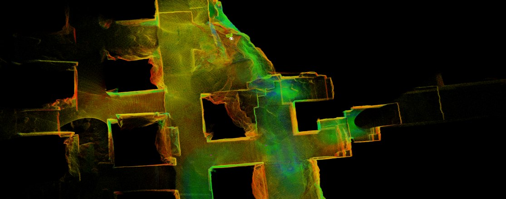

  <picture>
    <source media="(prefers-color-scheme: dark)" srcset="images/lynxdrone-logo-white.png">
    
  </picture>

<h1 align="center">PhoteryX</h1>

  <b>3D Inspection Suite</b> · <i>Suite d'inspection 3D</i>

  

  
  

  

  PhoteryX is your robot inspection workspace: explore 3D point clouds alongside the mission video, mark points of interest and export professional reports in a few clicks.
    
  <i>PhoteryX est votre espace d'inspection robotisée : explorez les nuages de points 3D avec la vidéo de la mission, marquez les points d'intérêt et exportez des rapports professionnels en quelques clics.</i>

---

## Choose your language · Choisissez votre langue

<table align="center">
  <tr>
    <td align="center" width="50%">
       
      
        
      Install · Activate · Update · Troubleshoot
        
    </td>
    <td align="center" width="50%">
       
      
        
      Installer · Activer · Mettre à jour · Dépanner
        
    </td>
  </tr>
</table>

## Features · Fonctionnalités

<table>
  <tr>
    <td align="center" width="25%">🧊 <b>3D point clouds</b> Nuages de points 3D</td>
    <td align="center" width="25%">🎥 <b>Mission video</b> Vidéo de mission</td>
    <td align="center" width="25%">📍 <b>Georeferencing</b> Géoréférencement</td>
    <td align="center" width="25%">📄 <b>PDF & Word reports</b> Rapports PDF et Word</td>
  </tr>
</table>

## Get started in 3 steps · En 3 étapes

|     | English                                          | Français                                                             |
| :-: | ------------------------------------------------ | -------------------------------------------------------------------- |
| 1️⃣  | **Download** the installer with the button above | **Téléchargez** le programme d'installation avec le bouton ci-dessus |
| 2️⃣  | **Install** it: _I Agree_ › _Install_ › _Finish_ | **Installez-le** : _J'accepte_ › _Installer_ › _Fermer_              |
| 3️⃣  | **Activate** it with your e-mail and license key | **Activez-le** avec votre e-mail et votre clé de licence             |

> Download link not working? Use the direct link: [PhoteryX Setup 5.2.8.exe](https://github.com/Lynxdrone/PhoteryX/releases/download/v5.2.8/PhoteryX.Setup.5.2.8.exe) 
> _Le bouton ne fonctionne pas ? Utilisez le lien direct ci-dessus._

## Support

  Need help? · Besoin d'aide ?
   
  <a href="mailto:contact@lynxdrone.fr"><b>contact@lynxdrone.fr</b></a>

 

  © Lynxdrone · Robotic Innovations

