# PhoteryX – Guide d'installation pour Windows

_[English version](installation-windows.md)_

PhoteryX est le logiciel d'inspection 3D de Lynxdrone. Il affiche côte à côte le nuage de points, la trajectoire et la vidéo de votre robot, et crée des rapports d'inspection.

**Concerne :** PhoteryX 5.x · Windows 10 et 11 (64 bits)

_Les captures d'écran montrent PhoteryX en anglais ; les libellés français sont indiqués dans le texte._

## Démarrage rapide

1. Vérifiez que votre ordinateur respecte la [configuration requise](#1-configuration-requise).
2. Lancez **PhoteryX Setup X.X.X.exe**, puis cliquez sur **J'accepte › Installer › Fermer** ([détails](#2-installer-photeryx)).
3. Saisissez votre e-mail, choisissez un code PIN à 4 chiffres, saisissez votre clé de licence et cliquez sur **Activer la licence** ([détails](#31-activer-votre-licence)).
4. Faites glisser vos fichiers de mission sur la zone **Création auto** ([détails](#32-créer-une-mission)).
5. Cliquez sur **Inspecter** pour explorer la mission, puis sur **Rapport** pour créer votre rapport ([détails](#33-inspecter-une-mission-et-créer-un-rapport)).

---

## 1. Configuration requise

|                 | Minimum                               | Recommandé                                                                       |
| --------------- | ------------------------------------- | -------------------------------------------------------------------------------- |
| Windows         | Windows 10, 64 bits                   | Windows 11, 64 bits                                                              |
| Processeur      | 4 cœurs (Intel Core i5 / AMD Ryzen 5) | 8 cœurs (Intel Core i7 / AMD Ryzen 7)                                            |
| Mémoire (RAM)   | 8 Go                                  | 16 Go ou plus                                                                    |
| Carte graphique | Carte graphique intégrée              | Carte dédiée (NVIDIA GeForce GTX 1650, RTX ou équivalent) avec 4 Go de mémoire |
| Espace disque   | 1 Go pour l'application               | SSD avec 50 Go libres pour vos missions                                          |
| Écran           | 1920 × 1080                           | 1920 × 1080 ou plus                                                              |

- **Internet :** nécessaire pour activer la licence la première fois. Ensuite, PhoteryX fonctionne hors ligne, mais connectez-le à Internet au moins une fois tous les 14 jours pour renouveler la licence.
- **Droits administrateur :** non nécessaires.

**Comment vérifier votre ordinateur :**

- Mémoire et Windows 64 bits : **Paramètres › Système › Informations système**.
- Carte graphique : **Gestionnaire des tâches** (<kbd>Ctrl</kbd> + <kbd>Maj</kbd> + <kbd>Échap</kbd>) › **Performances**. Chaque carte graphique apparaît sous le nom **GPU 0**, **GPU 1**, etc.

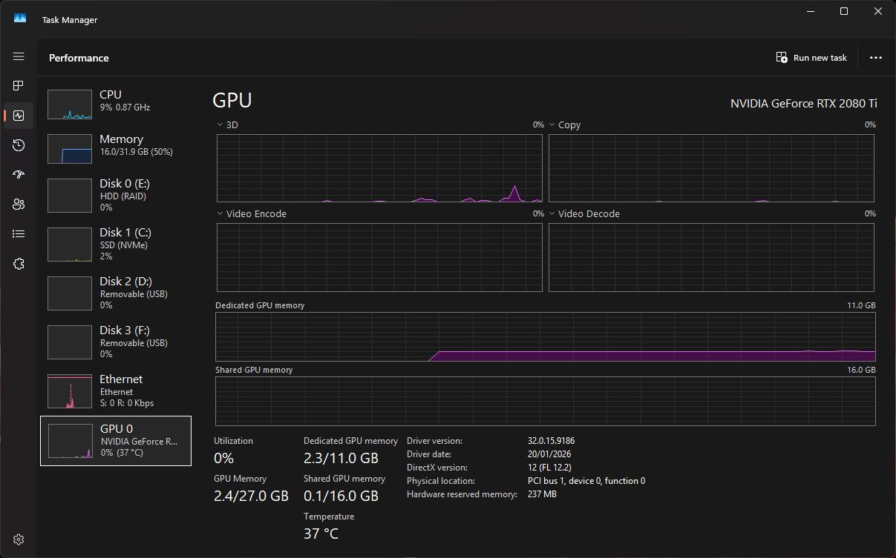

---

## 2. Installer PhoteryX

Vous n'avez pas besoin de désactiver votre antivirus. Le programme d'installation s'affiche dans la langue de Windows ; les libellés anglais sont indiqués entre parenthèses.

1. Double-cliquez sur **PhoteryX Setup X.X.X.exe** (fourni par Lynxdrone).

   Si Windows affiche une fenêtre bleue **Windows a protégé votre ordinateur**, cliquez sur **Informations complémentaires**, puis sur **Exécuter quand même**. C'est normal : Windows ne connaît pas encore le programme d'installation.

   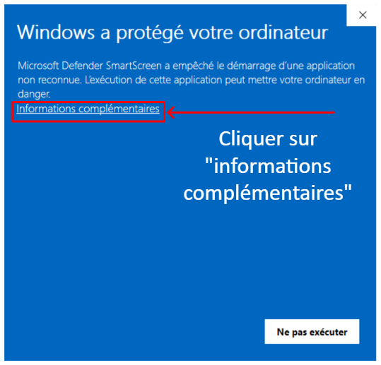
   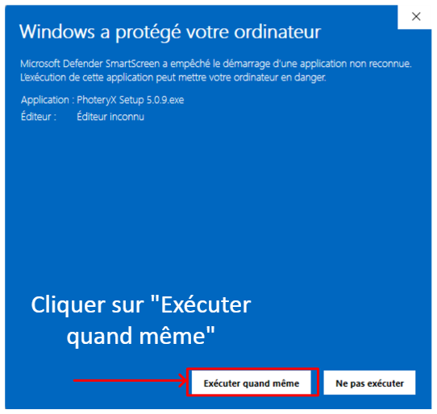

2. Lisez le contrat de licence et cliquez sur **J'accepte** (_I Agree_).

   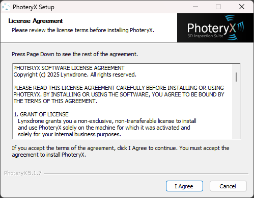

3. Choisissez **Juste pour moi** (_Only for me_) et cliquez sur **Installer** (_Install_).

   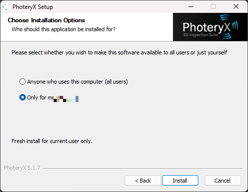

4. Patientez quelques minutes. Laissez **Lancer PhoteryX** (_Run PhoteryX_) coché et cliquez sur **Fermer** (_Finish_).

   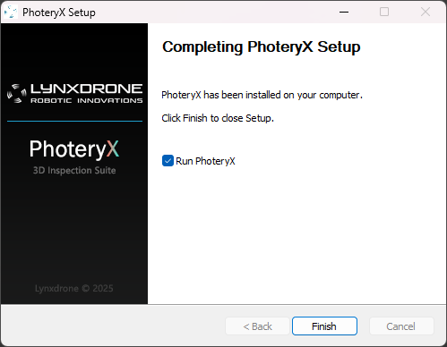

PhoteryX démarre. Un raccourci est aussi ajouté sur le Bureau et dans le menu Démarrer.

---

## 3. Utiliser PhoteryX

### 3.1 Activer votre licence

Connectez l'ordinateur à Internet. Pour afficher la fenêtre en français, cliquez sur **FR** en bas de la fenêtre. Remplissez ensuite les champs et cliquez sur **Activer la licence** :

| Champ                     | À saisir                                                                                  |
| ------------------------- | ----------------------------------------------------------------------------------------- |
| E-mail                    | Votre adresse e-mail enregistrée auprès de Lynxdrone.                                     |
| Code d'accès (4 chiffres) | Un code PIN de votre choix (ex. `1234`). Il vous servira à vous connecter, même hors ligne. |
| Clé de licence            | La clé fournie par Lynxdrone (`XXXX-XXXX-XXXX`).                                          |

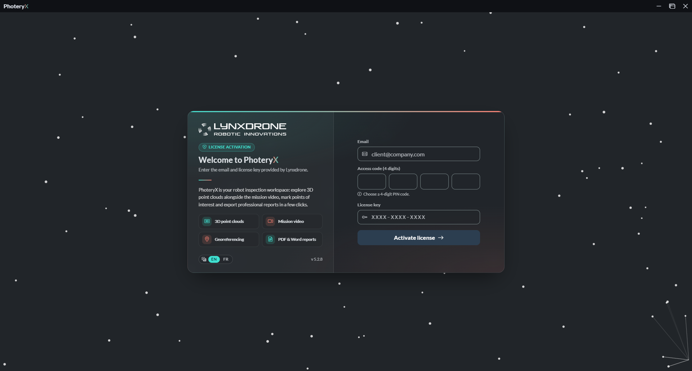

- **Les fois suivantes**, connectez-vous avec votre code PIN à 4 chiffres.
- **PIN oublié ?** Cliquez sur **PIN oublié ?**, saisissez votre e-mail et votre clé de licence, puis choisissez un nouveau PIN.
- **Langue :** cliquez sur **EN** ou **FR** en bas de la fenêtre.

### 3.2 Créer une mission

Une mission utilise jusqu'à quatre fichiers, un de chaque type (jusqu'à 8 Go environ chacun) :

| Fichier          | Contenu                                              |
| ---------------- | ---------------------------------------------------- |
| `.json`          | Informations de la mission (obligatoire, crée la mission) |
| `.csv`           | Trajectoire du robot                                 |
| `.laz` ou `.pcd` | Nuage de points 3D                                   |
| `.mp4`           | Vidéo d'inspection                                   |

Faites glisser les fichiers sur la zone **Création auto** du tableau de bord. PhoteryX crée la mission et téléverse les fichiers.

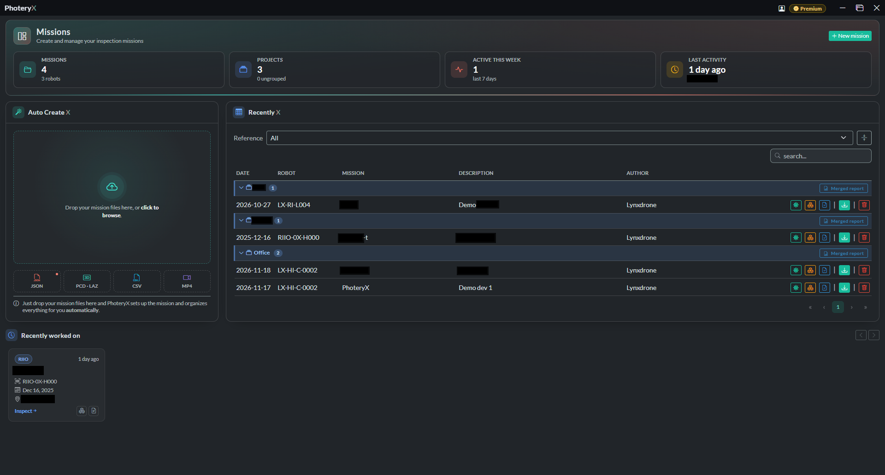

Chaque mission de la liste propose ces boutons (survolez un bouton pour afficher son nom) :

| Bouton                | Action                                                     |
| --------------------- | ---------------------------------------------------------- |
| Vert (contour)        | Inspecter la mission (apparaît quand la mission est prête) |
| Orange                | Ouvrir les détails de la mission et ajouter des fichiers   |
| Bleu                  | Créer un rapport                                           |
| Vert (téléchargement) | Télécharger toute la mission dans un fichier ZIP           |
| Rouge                 | Supprimer la mission                                       |

Vous pouvez aussi créer une mission manuellement : cliquez sur **Nouvelle mission**, remplissez le formulaire, cliquez sur **Enregistrer**, puis ajoutez les fichiers depuis les détails de la mission.

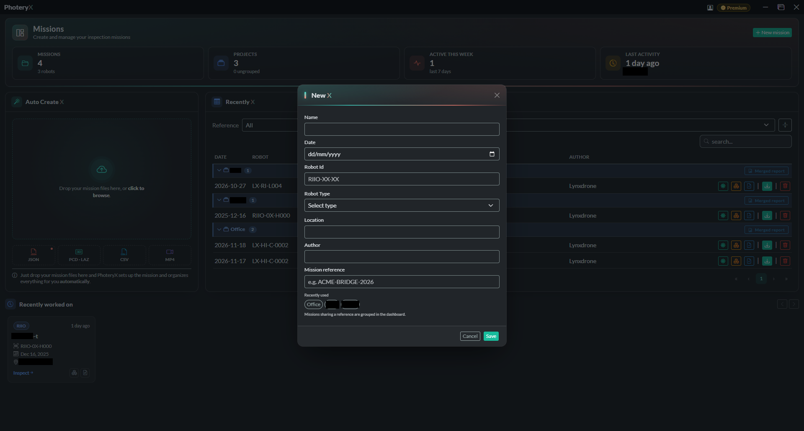

### 3.3 Inspecter une mission et créer un rapport

Cliquez sur le bouton orange d'une mission pour ouvrir ses détails : informations de la mission, état de chaque fichier (vert = téléversé) et liste des fichiers, que vous pouvez télécharger ou supprimer.

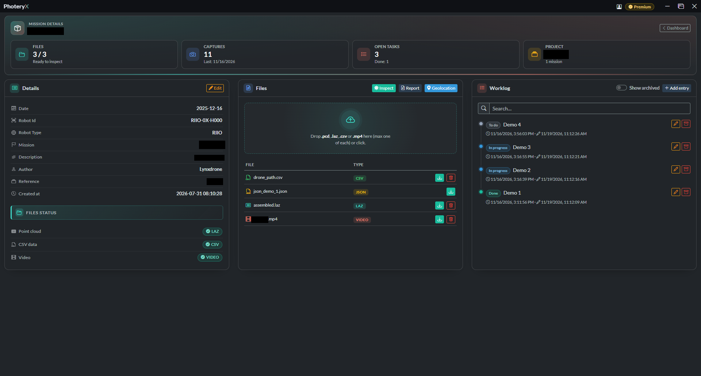

Cliquez sur **Inspecter** pour ouvrir la visionneuse : le nuage de points et la trajectoire à gauche, la vidéo synchronisée à droite, et les points d'intérêt sous la vidéo.

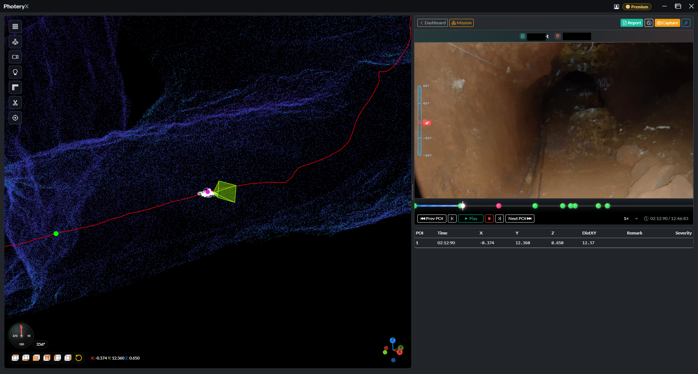

Cliquez sur **Rapport** (en haut à droite de la visionneuse, ou dans les détails de la mission) pour créer votre rapport d'inspection et l'exporter en PDF ou en Word.

---

## 4. Mettre à jour, sauvegarder et désinstaller

|                                       | Mise à jour  | Désinstallation |
| ------------------------------------- | :----------: | :-------------: |
| Missions et fichiers                  | ✅ Conservés | ❌ Supprimés    |
| Captures, points d'intérêt, remarques | ✅ Conservés | ❌ Supprimés    |
| Activation de la licence et code PIN  | ✅ Conservés | ❌ Supprimés    |
| Rapports déjà exportés                | ✅ Conservés | ✅ Conservés    |

### 4.1 Mettre à jour PhoteryX

> ⚠️ **Ne désinstallez pas PhoteryX pour le mettre à jour** : vous perdriez vos missions. Lancez simplement le nouveau programme d'installation.

1. Fermez PhoteryX.
2. Lancez le nouveau **PhoteryX Setup X.X.X.exe** et suivez les mêmes étapes que pour l'[installation](#2-installer-photeryx), en gardant **Juste pour moi**. Le programme d'installation affiche « Il y a déjà une installation par utilisateur. Va réinstaller/mettre à jour. » : vos données sont conservées.
3. Connectez-vous avec votre code PIN habituel. Le nouveau numéro de version s'affiche en bas de la fenêtre.

### 4.2 Sauvegarder une mission

1. Dans le tableau de bord, cliquez sur le bouton vert de téléchargement de la mission. PhoteryX télécharge toute la mission (fichiers et images des captures) dans un fichier ZIP.
2. Conservez ce fichier ZIP en dehors de PhoteryX, par exemple dans _Documents_ ou sur un disque externe.

Pour restaurer la mission, décompressez le fichier et faites glisser les fichiers de mission sur **Création auto**.

> Les points d'intérêt et les remarques ne sont pas inclus dans le fichier ZIP. Pour les conserver, créez et exportez un rapport.

### 4.3 Désinstaller PhoteryX

> ⚠️ **La désinstallation supprime définitivement toutes vos missions et tous vos fichiers sur cet ordinateur.** Sauvegardez-les d'abord ([4.2](#42-sauvegarder-une-mission)). Pour utiliser votre licence sur un autre ordinateur, désactivez-la d'abord ([4.4](#44-transférer-photeryx-sur-un-autre-ordinateur)).

1. Fermez PhoteryX.
2. Ouvrez **Paramètres › Applications › Applications installées** (Windows 10 : **Paramètres › Applications › Applications et fonctionnalités**).
3. Recherchez **PhoteryX**, cliquez sur **⋯** › **Désinstaller**, puis confirmez.

Pour réinstaller PhoteryX plus tard sur le même ordinateur, installez-le et activez-le à nouveau avec le même e-mail et la même clé de licence.

### 4.4 Transférer PhoteryX sur un autre ordinateur

Une licence fonctionne sur un seul ordinateur à la fois.

1. **Sur l'ancien ordinateur**, sauvegardez vos missions ([4.2](#42-sauvegarder-une-mission)).
2. **Toujours sur l'ancien ordinateur**, connecté à Internet : cliquez sur l'icône du compte (en haut à droite) › **Désactiver** › **OUI, désactiver**.
3. **Sur le nouvel ordinateur**, installez PhoteryX, activez-le avec le même e-mail et la même clé de licence, puis faites glisser vos fichiers de mission sauvegardés sur **Création auto**.

Si l'ancien ordinateur est en panne ou perdu, contactez Lynxdrone pour libérer votre licence.

---

## 5. Dépannage

### 5.1 PhoteryX ne démarre pas ou la licence ne s'active pas

- **Vérifiez votre connexion Internet.** La première activation en a besoin.
- **Licence déjà utilisée sur un autre ordinateur ?** Désactivez-la sur cet ordinateur ([4.4](#44-transférer-photeryx-sur-un-autre-ordinateur)) ou contactez Lynxdrone.
- **PhoteryX ne s'ouvre pas la première fois ?** Patientez une minute et relancez-le depuis le menu Démarrer.
- **Réseau d'entreprise ou antivirus ?** Demandez à votre service informatique d'autoriser PhoteryX (voir [Pour les administrateurs informatiques](#pour-les-administrateurs-informatiques)).
- **Toujours rien ?** Désactivez le pare-feu de votre antivirus uniquement pendant la première activation (environ 2 minutes), puis réactivez-le.

### 5.2 PhoteryX est lent

Sur les ordinateurs portables équipés de deux cartes graphiques, Windows peut faire tourner PhoteryX sur la moins puissante. Ouvrez **Gestionnaire des tâches › Performances** pendant que PhoteryX affiche une mission. Si la carte intégrée (par ex. _AMD Radeon_ ou _Intel UHD Graphics_) est très sollicitée alors que la carte _NVIDIA_ reste inactive, PhoteryX n'utilise pas la bonne carte.

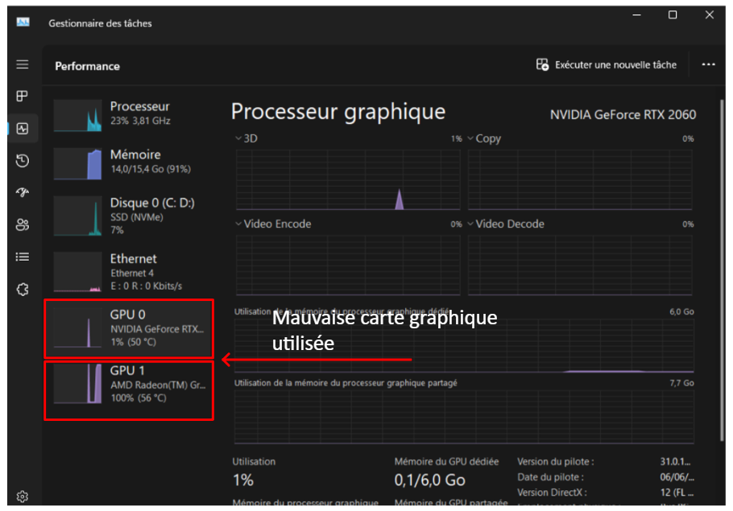

Pour corriger :

1. Ouvrez les **Paramètres**, recherchez **graphiques** et ouvrez **Paramètres graphiques**.
2. Sous **Ajouter une application de bureau**, cliquez sur **Parcourir**.
3. Collez `%LOCALAPPDATA%\Programs\PhoteryX` dans la barre d'adresse, appuyez sur <kbd>Entrée</kbd>, puis double-cliquez sur **PhoteryX**.

   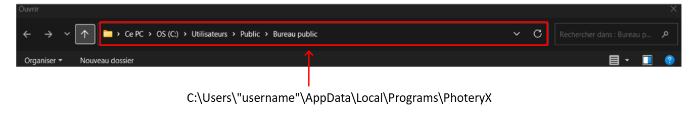
   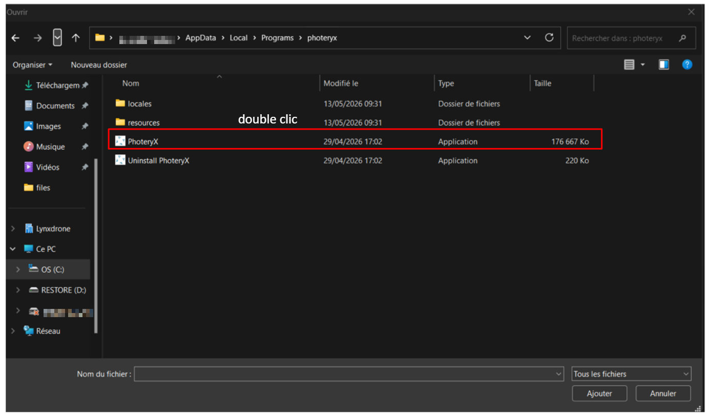

4. Cliquez sur PhoteryX dans la liste › **Options** › **Performances élevées** › **Enregistrer**.

   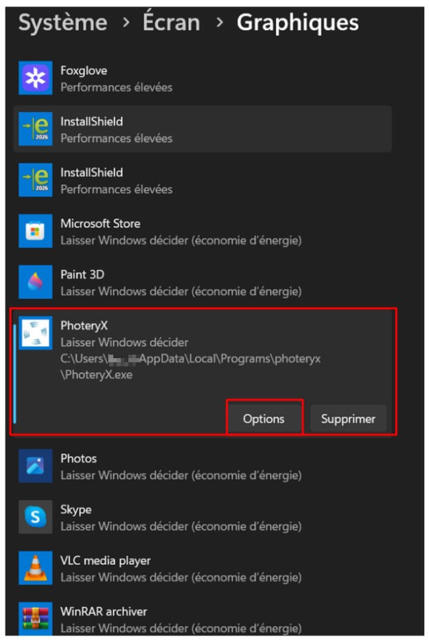

5. Relancez PhoteryX. La carte dédiée est maintenant utilisée.

   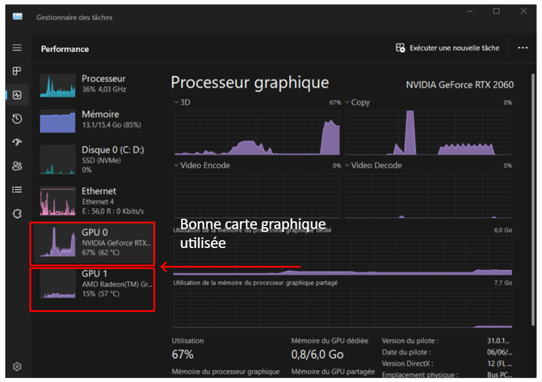                               |

---

**Besoin d'aide ?** Contactez Lynxdrone à contact@lynxdrone.fr.
