# PhoteryX – Installation Guide for Windows

_[Version française](installation-windows.fr.md)_

PhoteryX is Lynxdrone's 3D inspection software. It shows your robot's point cloud, trajectory and video side by side, and creates inspection reports.

**Applies to:** PhoteryX 5.x · Windows 10 and 11 (64-bit)

## Quick start

1. Check that your computer meets the [requirements](#1-requirements).
2. Run **PhoteryX Setup X.X.X.exe**, then click **I Agree › Install › Finish** ([details](#2-install-photeryx)).
3. Enter your e-mail, choose a 4-digit PIN, enter your license key and click **Activate license** ([details](#31-activate-your-license)).
4. Drag your mission files onto the **Auto Create** zone ([details](#32-create-a-mission)).
5. Click **Inspect** to explore the mission, then **Report** to create your report ([details](#33-inspect-a-mission-and-create-a-report)).

---

## 1. Requirements

|               | Minimum                               | Recommended                                                                  |
| ------------- | ------------------------------------- | ---------------------------------------------------------------------------- |
| Windows       | Windows 10, 64-bit                    | Windows 11, 64-bit                                                           |
| Processor     | 4 cores (Intel Core i5 / AMD Ryzen 5) | 8 cores (Intel Core i7 / AMD Ryzen 7)                                        |
| Memory (RAM)  | 8 GB                                  | 16 GB or more                                                                |
| Graphics card | Integrated graphics                   | Dedicated card (NVIDIA GeForce GTX 1650, RTX or equivalent) with 4 GB memory |
| Disk space    | 1 GB for the application              | SSD with 50 GB free for your missions                                        |
| Screen        | 1920 × 1080                           | 1920 × 1080 or higher                                                        |

- **Internet:** needed to activate the license the first time. After that, PhoteryX works offline, but connect it to the Internet at least once every 15 days to renew the license.
- **Administrator rights:** not needed.

**How to check your computer:**

- Memory and 64-bit Windows: **Settings › System › About**.
- Graphics card: **Task Manager** (<kbd>Ctrl</kbd> + <kbd>Shift</kbd> + <kbd>Esc</kbd>) › **Performance**. Each graphics card is listed as **GPU 0**, **GPU 1**, and so on.

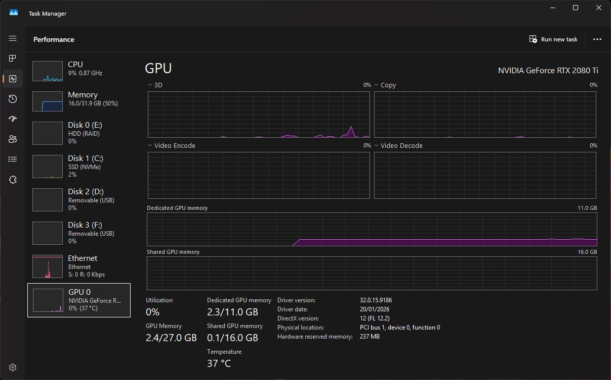

---

## 2. Install PhoteryX

You do not need to disable your antivirus.

1. Double-click **PhoteryX Setup X.X.X.exe** (provided by Lynxdrone).

   If Windows shows a blue **Windows protected your PC** window, click **More info**, then **Run anyway**. This is normal: Windows does not know the installer yet. On a French Windows, the buttons are *Informations complémentaires* and *Exécuter quand même*.

   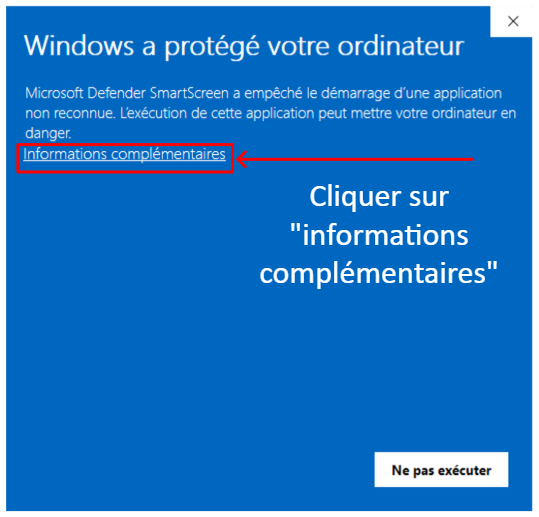
   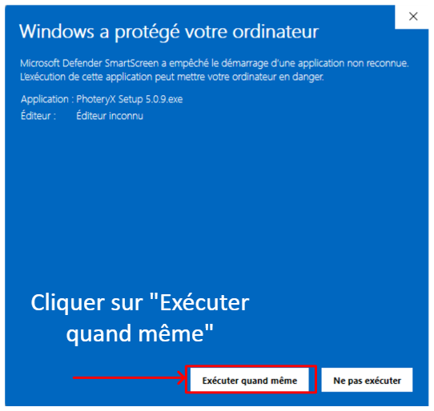

2. Read the license agreement and click **I Agree**.

   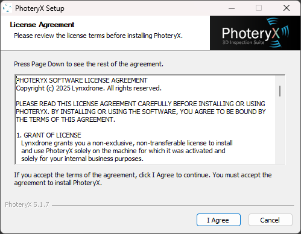

3. Choose **Only for me** and click **Install**.

   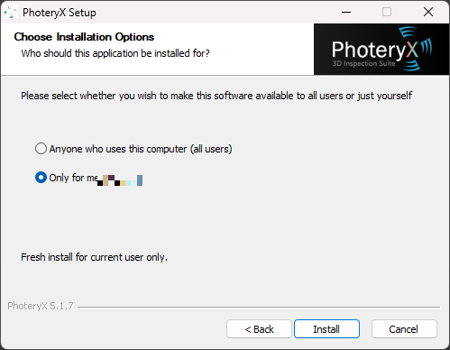

4. Wait a few minutes. Leave **Run PhoteryX** checked and click **Finish**.

   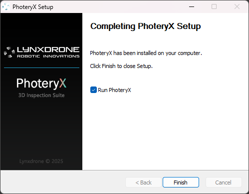

PhoteryX starts. A shortcut is also added to the desktop and the Start menu.

---

## 3. Using PhoteryX

### 3.1 Activate your license

Connect the computer to the Internet, fill in the window and click **Activate license**:

| Field       | What to enter                                                                         |
| ----------- | ------------------------------------------------------------------------------------- |
| Email       | Your e-mail address registered with Lynxdrone.                                        |
| Access code | A 4-digit PIN of your choice (e.g. `1234`). You will use it to sign in, even offline. |
| License key | The key provided by Lynxdrone (`XXXX-XXXX-XXXX`).                                     |

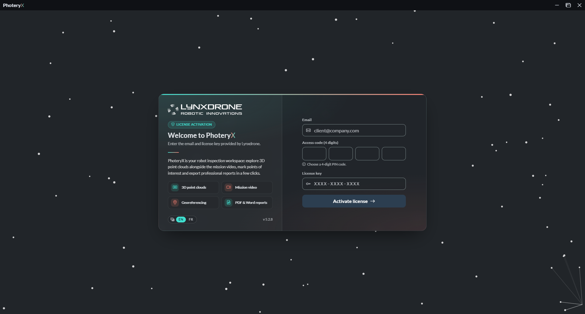

- **Next time**, sign in with your 4-digit PIN.
- **Forgot your PIN?** Click **Forgot your PIN?**, enter your e-mail and license key, and choose a new PIN.
- **Language:** click **EN** or **FR** at the bottom of the window.

### 3.2 Create a mission

A mission uses up to four files, one of each type (up to about 8 GB each):

| File             | Content                                          |
| ---------------- | ------------------------------------------------ |
| `.json`          | Mission information (required, creates the mission) |
| `.csv`           | Robot trajectory                                 |
| `.laz` or `.pcd` | 3D point cloud                                   |
| `.mp4`           | Inspection video                                 |

Drag the files onto the **Auto Create** zone of the dashboard. PhoteryX creates the mission and uploads the files.

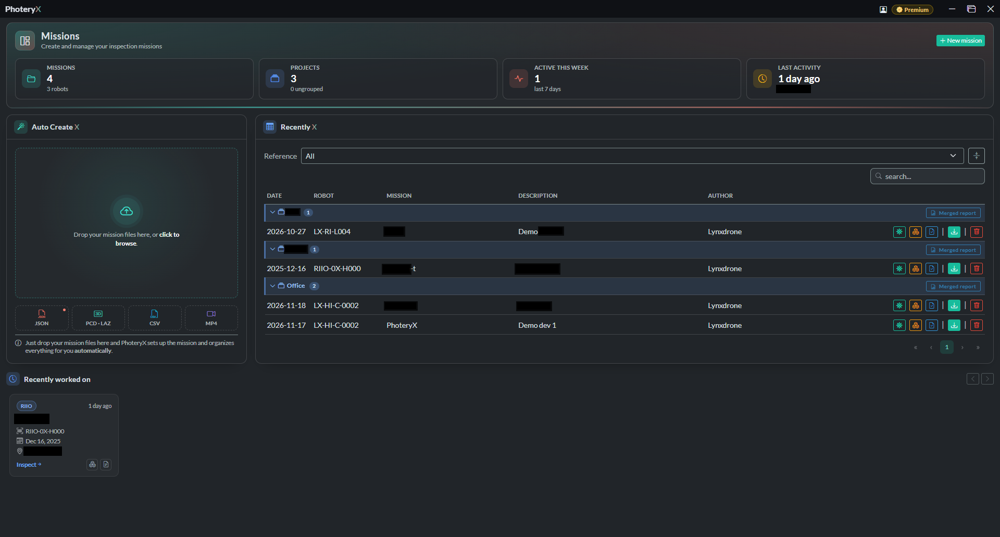

Each mission in the list has these buttons (hover over a button to see its name):

| Button           | Action                                                 |
| ---------------- | ------------------------------------------------------ |
| Green outline    | Inspect the mission (appears when the mission is ready) |
| Orange           | Open the mission details and add files                 |
| Blue             | Create a report                                        |
| Green (download) | Download the whole mission as a ZIP file               |
| Red              | Delete the mission                                     |

You can also create a mission by hand: click **New mission**, fill in the form, click **Save**, then add the files from the mission details.

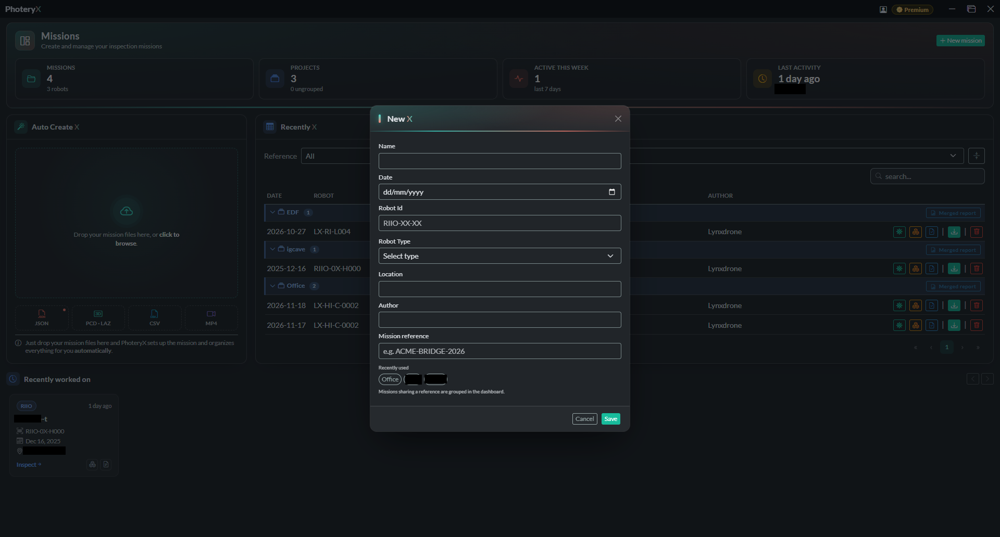

### 3.3 Inspect a mission and create a report

Click the orange button of a mission to open its details: mission information, status of each file (green = uploaded) and the list of files, which you can download or delete.

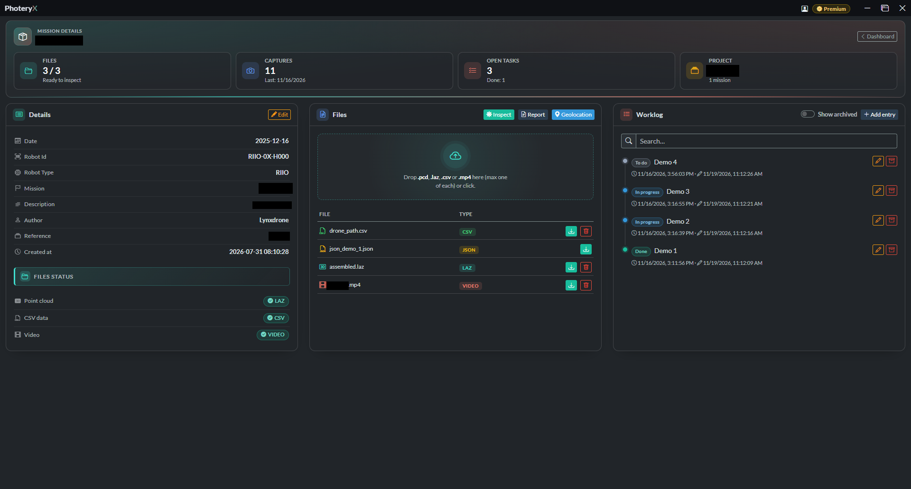

Click **Inspect** to open the viewer: the point cloud and trajectory on the left, the synchronized video on the right, and the points of interest below the video.

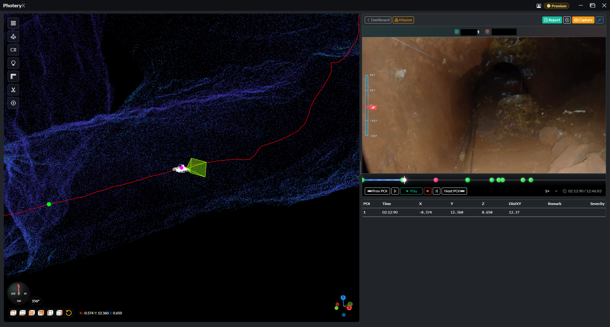

Click **Report** (top right of the viewer, or in the mission details) to create your inspection report and export it to PDF or Word.

---

## 4. Update, back up and uninstall

|                                       | Update  |  Uninstall  |
| ------------------------------------- | :-----: | :---------: |
| Missions and files                    | ✅ Kept | ❌ Deleted |
| Captures, points of interest, remarks | ✅ Kept | ❌ Deleted |
| License activation and PIN            | ✅ Kept | ❌ Deleted |
| Reports already exported              | ✅ Kept |   ✅ Kept   |

### 4.1 Update PhoteryX

> ⚠️ **Do not uninstall PhoteryX to update it**: you would lose your missions. Just run the new installer.

1. Close PhoteryX.
2. Run the new **PhoteryX Setup X.X.X.exe** and follow the same steps as for the [installation](#2-install-photeryx), keeping **Only for me**. The installer shows _"There is already a per-user installation. Will reinstall/upgrade."_: your data is kept.
3. Sign in with your usual PIN. The new version number is shown at the bottom of the window.

### 4.2 Back up a mission

1. In the dashboard, click the green download button of the mission. PhoteryX downloads the whole mission (files and capture images) as a ZIP file.
2. Keep this ZIP file outside PhoteryX, for example in _Documents_ or on an external drive.

To restore the mission, unzip the file and drag the mission files onto **Auto Create**.

> Points of interest and remarks are not in the ZIP file. To keep them, create and export a report.

### 4.3 Uninstall PhoteryX

> ⚠️ **Uninstalling permanently deletes all your missions and files on this computer.** Back them up first ([4.2](#42-back-up-a-mission)). To use your license on another computer, deactivate it first ([4.4](#44-move-photeryx-to-another-computer)).

1. Close PhoteryX.
2. Open **Settings › Apps › Installed apps** (Windows 10: **Settings › Apps › Apps & features**).
3. Search for **PhoteryX**, click **⋯** › **Uninstall**, and confirm.

To reinstall PhoteryX later on the same computer, install it and activate it again with the same e-mail and license key.

### 4.4 Move PhoteryX to another computer

A license works on one computer at a time.

1. **On the old computer**, back up your missions ([4.2](#42-back-up-a-mission)).
2. **Still on the old computer**, connected to the Internet: click the account icon (top right) › **Deactivate** › **YES, deactivate**.
3. **On the new computer**, install PhoteryX, activate it with the same e-mail and license key, and drag your saved mission files onto **Auto Create**.

If the old computer is broken or lost, contact Lynxdrone to release your license.

---

## 5. Troubleshooting

### 5.1 PhoteryX does not start or the license is not activated

- **Check your Internet connection.** The first activation needs it.
- **License already used on another computer?** Deactivate it there ([4.4](#44-move-photeryx-to-another-computer)) or contact Lynxdrone.
- **PhoteryX does not open the first time?** Wait a minute and start it again from the Start menu.
- **Company network or antivirus?** Ask your IT department to allow PhoteryX (see [For IT administrators](#for-it-administrators)).
- **Still not working?** Turn off your antivirus firewall during the first activation only (about 2 minutes), then turn it back on.

### 5.2 PhoteryX is slow

On laptops with two graphics cards, Windows may run PhoteryX on the less powerful one. Open **Task Manager › Performance** while PhoteryX displays a mission. If the integrated card (e.g. _AMD Radeon_ or _Intel UHD Graphics_) is busy while the _NVIDIA_ card is idle, PhoteryX is using the wrong card.

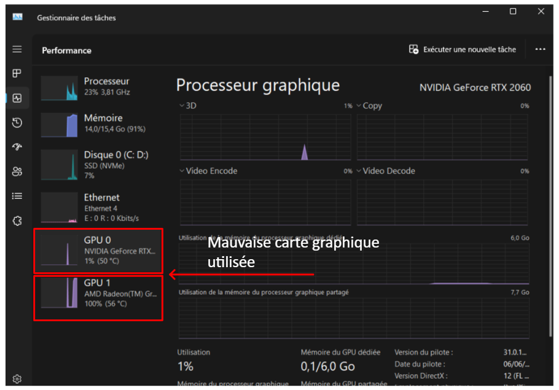

To fix it:

1. Open **Settings**, search for **graphics** and open **Graphics settings**.
2. Under **Add desktop app**, click **Browse**.
3. Paste `%LOCALAPPDATA%\Programs\PhoteryX` into the address bar, press <kbd>Enter</kbd>, and double-click **PhoteryX**.

   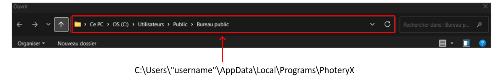
   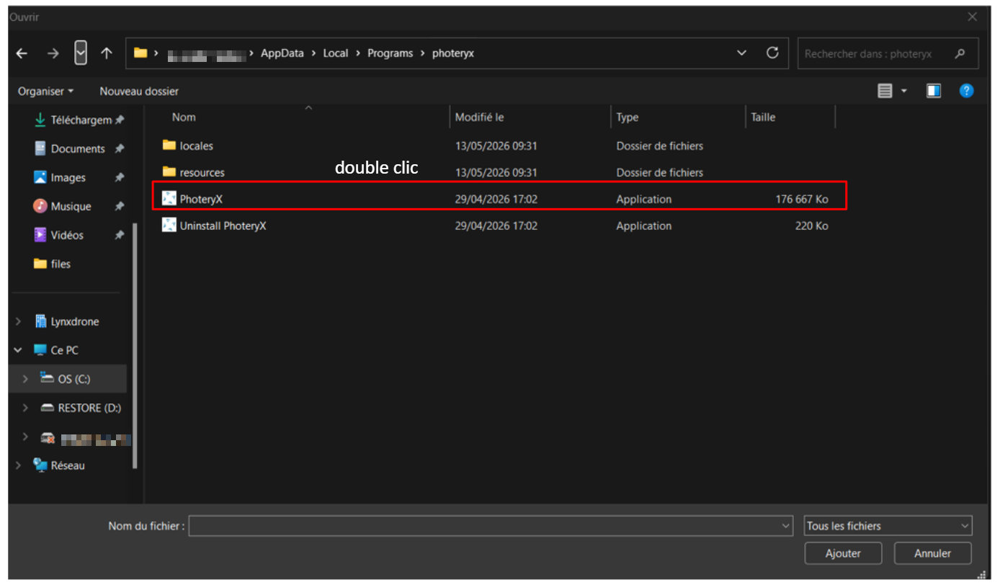

4. Click PhoteryX in the list › **Options** › **High performance** › **Save**.

   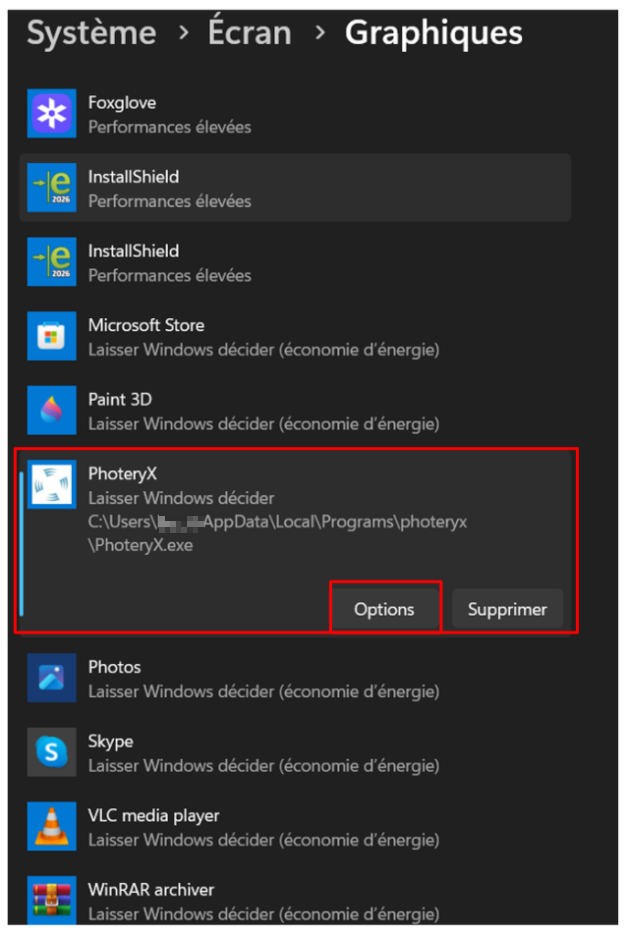

5. Restart PhoteryX. The dedicated card is now used.

   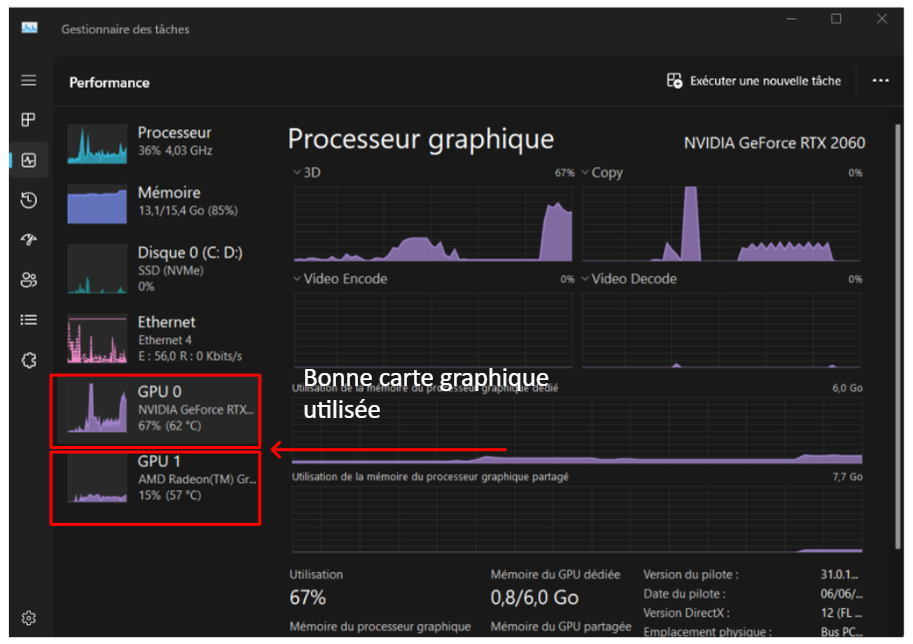

---

## For IT administrators

| Item                | Details                                                                                                                                 |
| ------------------- | --------------------------------------------------------------------------------------------------------------------------------------- |
| License server      | Outbound HTTPS (TCP 443) to `inspectorx-license-server-vj00.onrender.com`, for license activation and renewal.                          |
| Local service       | PhoteryX runs a background service on `127.0.0.1`, TCP port 4451. Local connections only: no inbound firewall rule is needed. The port must be free. |
| Installation folder | `%LOCALAPPDATA%\Programs\PhoteryX` (per-user installation, no administrator rights).                                                    |
| Antivirus           | If PhoteryX files are blocked or quarantined, add an exclusion for the installation folder.                                            |

---

**Need help?** Contact Lynxdrone at contact@lynxdrone.fr.
